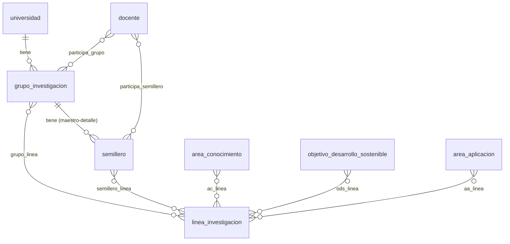

# Modelo de datos — Versión 2: tablas con llave foránea y un maestro-detalle

> **Versión 2** · La base sigue siendo `investigacion` (MariaDB). Lo que cambia
> es **cuánto de ella usa el código**: de seis tablas de catálogo sin relaciones
> a trece, con sus llaves foráneas y, por primera vez, procedimientos
> almacenados.
>
> Este documento es el que hay que tener al lado mientras se construye:
> explica no solo qué columnas hay, sino **quién defiende qué**.

> **Estado:** las tablas marcadas **[PROPUESTA]** no vienen de un esquema
> oficial verificado. Se contrastan con `db_scripts/mysql/investigacion.sql`
> (Art. 5). Si el oficial difiere, manda el oficial.

---

## 1. El script de la BD (artefacto de esta versión)

Son dos archivos que Docker ejecuta en orden alfabético al crear el volumen:

| Archivo | Qué hace |
|---|---|
| `db/init.sql` | La v1: crea `investigacion` y las seis tablas de catálogo, con `activo` y sus datos de ejemplo. **No se toca** |
| `db/procedimientos_v2.sql` | La v2: crea las tablas nuevas, sus semillas y los cinco procedimientos del grupo. Se puede correr varias veces (`IF NOT EXISTS`, `CREATE OR REPLACE`) |

**Cambios al esquema** (van numerados en la cabecera del script, Art. 5):

| # | Cambio | Motivo |
|---|---|---|
| C1 | `activo` en `docente`, `grupo_investigacion` y `semillero` | Borrado lógico (Art. 6) |
| C2 | Las siete tablas puente **no** llevan `activo` | Volver a asignar una pareja retirada chocaría con la llave primaria y daría un 409 absurdo |
| C3 | Ningún disparador | La v2 no los pide |

> **Ojo con el nombre de la base:** `MARIADB_DATABASE` en el
> `docker-compose.yml` debe ser **`investigacion`**, igual que en el script.
> Si dice otro nombre, los `.sql` corren en una base distinta de la que lee la API.

## 2. El mapa de las tablas que usa la v2



Léalo así: **hay tablas de las que otras dependen** (las de la v1, y `docente`)
y tablas que dependen de alguien (`grupo_investigacion`, `semillero` y las
puente). Esa forma decide dos cosas prácticas:

- **Para crear**, se va de las que no dependen a las que sí: primero la
  universidad, después el grupo, después el semillero. Al revés, la base
  rechaza (error 1452).
- **Para retirar**, al revés: primero los semilleros, después el grupo. Con
  borrado lógico la base **no** lo impide sola (es un `UPDATE`), así que lo
  impide el procedimiento con un `SIGNAL`.

Los dos rechazos son los que la API traduce a **409**.

## 3. Las tablas, una por una

### 3.1 Las seis de la v1 — no se tocan

`area_conocimiento`, `objetivo_desarrollo_sostenible`, `area_aplicacion`,
`termino_clave`, `universidad` y `linea_investigacion`. Su estructura está en
el `5_data_model.md` de la v1. En la v2 pasan a ser **los padres** que
alimentan los desplegables.

### 3.2 `docente` **[PROPUESTA]** — no depende de nadie

| Columna | Tipo | Restricción | Descripción |
|---|---|---|---|
| `cedula` | INT | **PK** | La escribe quien crea la ficha |
| `nombres` | VARCHAR(100) | NOT NULL | |
| `apellidos` | VARCHAR(100) | NOT NULL | |
| `activo` | TINYINT(1) | NOT NULL, DEFAULT 1 | **Solo lo cambia `DELETE`** |

Es el padre de dos tablas puente (`participa_grupo` y `participa_semillero`).

### 3.3 `grupo_investigacion` — **el maestro**

| Columna | Tipo | Restricción | Quién lo escribe |
|---|---|---|---|
| `id` | INT | **PK, AUTO_INCREMENT** | **la base** |
| `gruplac` | VARCHAR(255) | NOT NULL | la API |
| `categoria` | VARCHAR(50) | NOT NULL | la API |
| `convocatoria` | VARCHAR(255) | NOT NULL | la API |
| `ambito` | VARCHAR(255) | NOT NULL | la API |
| `universidad_id` | INT | **FK → universidad**, NOT NULL | la API |
| `activo` | TINYINT(1) | NOT NULL, DEFAULT 1 | **el procedimiento de retirar** |

El grupo **no tiene `nombre`**: se identifica por su `gruplac`. Y como el `id`
lo genera la base, el `POST` **no lo lleva** y la respuesta **sí lo devuelve**.

### 3.4 `semillero` **[PROPUESTA]** — **el detalle**

| Columna | Tipo | Restricción | Quién lo escribe |
|---|---|---|---|
| `id` | INT | **PK, AUTO_INCREMENT** | **la base** |
| `nombre` | VARCHAR(100) | NOT NULL | la API |
| `grupo_id` | INT | **FK → grupo_investigacion**, NOT NULL | **el procedimiento** (toma el id del grupo que acaba de crear) |
| `activo` | TINYINT(1) | NOT NULL, DEFAULT 1 | **el procedimiento** |

**Un semillero no existe sin su grupo.** Por eso no se crea suelto: nace dentro
del `sp_crear_grupo_investigacion`. Lea la columna «quién lo escribe»: la API
**no manda** `grupo_id`; el procedimiento lo pone con `LAST_INSERT_ID()`.

### 3.5 Las siete tablas puente **[PROPUESTA]**

Su llave primaria es **compuesta**: las dos llaves foráneas juntas. Por eso una
pareja no puede repetirse (error 1062 → `409`), y por eso **no se editan**:
cambiar un lado es otra pareja, o sea retirar una y asignar otra.

| Tabla | Columnas (= llave) | Apuntan a |
|---|---|---|
| `participa_grupo` | `docente_cedula`, `grupo_id` | `docente`, `grupo_investigacion` |
| `participa_semillero` | `docente_cedula`, `semillero_id` | `docente`, `semillero` |
| `grupo_linea` | `grupo_id`, `linea_id` | `grupo_investigacion`, `linea_investigacion` |
| `semillero_linea` | `semillero_id`, `linea_id` | `semillero`, `linea_investigacion` |
| `ac_linea` | `area_conocimiento_id`, `linea_id` | `area_conocimiento`, `linea_investigacion` |
| `ods_linea` | `ods_id`, `linea_id` | `objetivo_desarrollo_sostenible`, `linea_investigacion` |
| `aa_linea` | `area_aplicacion_id`, `linea_id` | `area_aplicacion`, `linea_investigacion` |

**Sin `activo`:** retirar una pareja es un `DELETE FROM`. Si llevaran `activo`,
volver a asignar una pareja retirada chocaría con su propia llave.

## 4. La lógica que vive en la base

### 4.1 Los cinco procedimientos del maestro-detalle

Solo para `grupo_investigacion → semillero`. Las demás tablas usan SQL con
parámetros `?` en su repositorio, como en la v1.

| Procedimiento | Qué hace | Devuelve | Lo llama |
|---|---|---|---|
| `sp_listar_grupo_investigacion()` | Los grupos activos | 1 resultado | `obtenerTodos()` |
| `sp_consultar_grupo_investigacion(id)` | Un grupo y sus semilleros activos | 2 resultados | `obtenerPorId()` |
| `sp_crear_grupo_investigacion(..., detalle)` | Crea el grupo y todos sus semilleros | 2 resultados | `crear()` |
| `sp_actualizar_grupo_investigacion(id, ..., detalle)` | Reemplaza el grupo y **todo** el detalle (`PUT`) | 2 resultados | `reemplazar()` |
| `sp_eliminar_grupo_investigacion(id)` | Retira el grupo (`activo = 0`) | nada | `eliminar()` |

Cómo funcionan, para poder explicarlo en voz alta:

- **El detalle viaja como un solo parámetro JSON**: `[{"nombre":"Semillero A"}]`.
  El procedimiento lo recorre con `JSON_TABLE` (pide MariaDB 10.6 o superior;
  la imagen `mariadb:11` lo cumple).
- **Todo o nada:** crear y actualizar abren una transacción y tienen un
  `EXIT HANDLER FOR SQLEXCEPTION` que hace `ROLLBACK` y `RESIGNAL`. Si falla
  el tercer semillero, no queda ni el grupo.
- **El `LAST_INSERT_ID()` se guarda en una variable al instante**, antes de
  cualquier otra sentencia: otro `INSERT` lo cambiaría.
- **Devuelven lo que quedó guardado**, no lo que mandó el formulario (MariaDB
  no tiene `RETURNING`). Por eso la respuesta trae el `id` generado.
- **`PUT` retira los semilleros de antes y reinserta los nuevos**, así que los
  semilleros cambian de `id` en cada `PUT`.

### 4.2 Las dos señales que lanzan los procedimientos

| SQLSTATE | Cuándo | La API responde |
|---|---|---|
| `45001` | El grupo no existe o está retirado | `404` |
| `45000` | Se intenta retirar un grupo con semilleros activos | `409` con el mensaje del `SIGNAL` |

> `45001` es una decisión de esta versión: la guía solo nombra `45000`. Se
> prefiere a distinguir los casos leyendo el **texto** del mensaje, que es
> frágil. Si el profesor no la acepta, se cambia en `errores_de_integridad.php`.

### 4.3 Las demás defensas son de la llave

| Qué pasa | Quién lo rechaza | Error del motor | La API responde |
|---|---|---|---|
| Crear con un `universidad_id` que no existe | La llave foránea | 1452 | `409` |
| Repetir una pareja en una puente | La llave primaria | 1062 | `409` |
| Borrar un padre con hijos (solo borrado físico) | La llave foránea | 1451 | `409` |

El 1451 casi no se dispara con borrado lógico, pero se sigue traduciendo por
seguridad.

### 4.4 Las tablas que la v2 no toca

`rol`, `usuario` y `rol_usuario` son del control de acceso (v3). **El código de
la v2 no puede nombrarlas.**

## 5. Los datos de ejemplo de los que dependen las pruebas

El `7_quickstart.md` cuenta con esto. Si alguien cambia los datos, hay que
actualizarlo.

| Tabla | Cuántos | Un ejemplo que se usa en las pruebas |
|---|---|---|
| `universidad` | 2 | `id = 1` Monte Verde — es el padre del grupo 1 |
| `linea_investigacion` | 2 | `id = 1` Desarrollo de Software |
| `docente` | 2 | `cedula = 1017245` Ana Torres Gómez |
| `grupo_investigacion` | 1 | `id = 1` — **tiene 2 semilleros**: retirarlo debe dar `409` |
| `semillero` | 2 | Los dos pertenecen al grupo 1 |
| `grupo_linea` | 1 | La pareja `(1, 1)` — repetirla debe dar `409` |

> Los números de la v1 (218, 17, 21 y 6) son los del dataset oficial. El
> `init.sql` actual solo trae 2 por tabla. Si cargas el dataset completo,
> actualiza esta tabla y la del quickstart de la v1.

**Para que esos datos existan**, agrega esto al final de la sección de
semillas de `db/procedimientos_v2.sql` (después de crear las tablas):

```sql
INSERT IGNORE INTO grupo_investigacion (id, gruplac, categoria, convocatoria, ambito, universidad_id)
VALUES (1, 'COL0001', 'A', 'Convocatoria 2024', 'Nacional', 1);

INSERT IGNORE INTO semillero (id, nombre, grupo_id) VALUES
(1, 'Semillero de Visión Artificial', 1),
(2, 'Semillero de Lenguaje Natural', 1);

INSERT IGNORE INTO grupo_linea (grupo_id, linea_id) VALUES (1, 1);
```

## 6. Montar la BD

```powershell
docker compose up -d mariadb      # desde la raíz del proyecto
```

Y el botón de pánico, que en esta versión se usa más porque las pruebas crean y
retiran registros:

```powershell
docker compose down -v && docker compose up -d --build
```

`down -v` borra el volumen, así que los dos `.sql` vuelven a ejecutarse y la
base queda como recién nacida.

## 7. Qué toca el código en cada versión

| Versión | Tablas que usa el código (API **y** pantalla) |
|---|---|
| v1 | Las 6 de catálogo |
| **v2** | **+ `docente`, `grupo_investigacion`, `semillero` y las 7 puente** |
| v3 | **+ `usuario`, `rol` y `rol_usuario`** |

## 8. Lo que NO se cambia

- Las seis tablas de la v1 y sus datos.
- Nombres de columnas y tipos del esquema oficial, aunque tengan errores de
  digitación.

## 9. El modelo está listo cuando…

- [ ] `docker compose up -d --build` crea todo sin error y el script corre dos veces seguidas.
- [ ] `MARIADB_DATABASE` y el script usan el mismo nombre: `investigacion`.
- [ ] La cabecera del script numera los cambios al esquema (C1 a C3).
- [ ] Las llaves foráneas rechazan padres inexistentes (1452).
- [ ] Crear un grupo con 3 semilleros guarda los 4 registros, o ninguno.
- [ ] Retirar un grupo con semilleros activos lanza `45000`.
- [ ] Un grupo inexistente lanza `45001`.
- [ ] Repetir una pareja en una puente da 1062.
- [ ] Los datos de §5 existen y coinciden con el quickstart.
